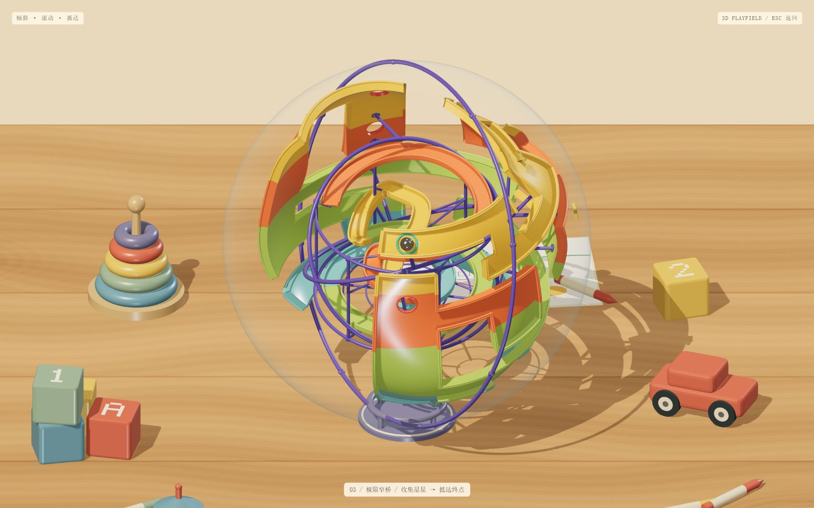
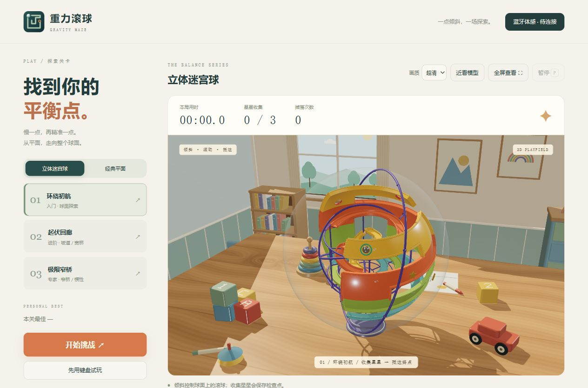
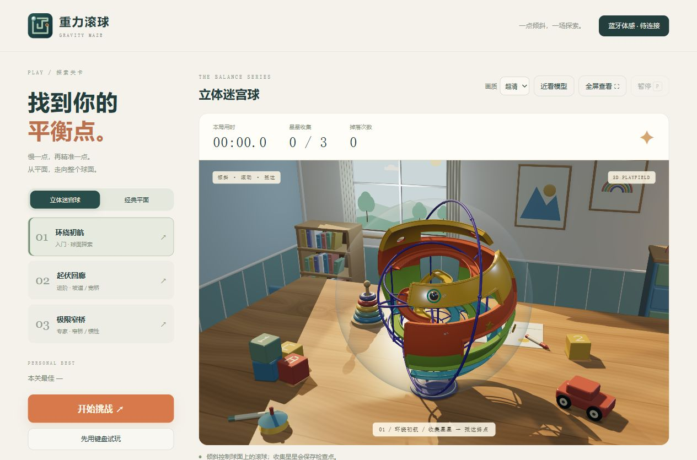
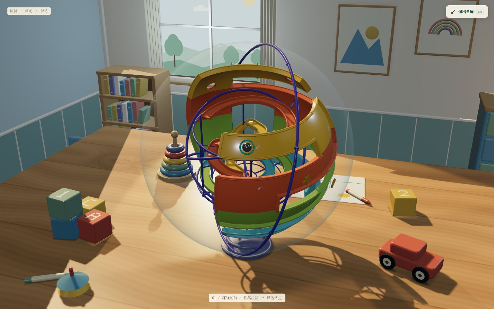

# 重力滚球 · GRAVITY MAZE

独立的三维体感迷宫游戏。整个 `gravity-maze` 文件夹可单独复制运行，无需空战目录。

双击 `start-maze.cmd`，或桌面「重力滚球」快捷方式。需要 Python 3.10+ 和支持 WebGL 2 的 Chrome / Edge。默认端口 8890，关闭最后一个网页 2 秒后退出服务。图标为原创迷宫与金属球图案。

包含「立体迷宫球」与「经典平面」两种模式，各有三个固定关卡；收齐三颗星星再到终点。平面掉落返回起点，球面掉落返回最近星星检查点，均保留已收集的星星。支持蓝牙、USB、键盘和触屏。默认蓝牙模式；连接开发板、静置校准、设置中位后开始。使用原 USB + BLE 双模式固件，无需重新烧录。SDA GPIO4，SCL GPIO5，VCC 3V3，GND 共地。

方向键 / WASD 倾斜；空格刹车；P / Esc 暂停。打开设置或切换窗口自动暂停。最佳成绩与操控设置独立保存在本游戏浏览器来源中。

`dist/maze-model.js` 是独立三维模型，`maze-physics.js` 为关卡与物理，`maze.js` 为游戏状态，`app.css` 为专属界面。控制器预览只加载陀螺仪模型。依赖均在本目录；Three.js 许可证见 `dist/vendor/LICENSE.txt`。

检查：`node gravity-maze/test-maze.mjs`。

## 当前控制器方向（2026-10-15 串口实测）

COM29 静置重新校准约 2.21 秒完成。当前握持下，前边向下压低对应负俯仰（约 −14.3°），右边向下压低对应负横滚（约 −12°）。因此使用前进方向 +X、左右反向开启、上下反向关闭、不交换轴。

本版本首次打开自动应用这组方向设置，并保留灵敏度与死区；之后手动修改的设置会保留。重新连接后仍需将控制器放回舒适水平姿态，点击「以当前姿态为中位」。不要在测试倾斜状态下设置中位。无需重新烧录固件。实测为短时检查，不代表长时间零漂保证。

方向回归：`node gravity-maze/test-grip.mjs`，使用本次实测的水平、前倾和右倾样本验证游戏最终输出。

## 立体迷宫球与材质升级

首页默认「立体迷宫球」，可随时切回「经典平面」。切换模式或关卡会重新开始，蓝牙 / USB 连接保留。两种模式的最佳成绩分开保存。

- 环绕初航：在覆盖球体大部分周向的迷宫通道中探索，练习自动环绕视角。
- 起伏回廊：通道沿球面起伏，加入两段金色窄桥，坡度会产生额外滑动。
- 极限窄桥：更窄的三段桥、更明显的坡道和更大的惯性；空格刹车仍然有效。
- 球面模式的星星同时是检查点，掉落后在最近收集的星星处继续，计时不中断。
- 木桌场景使用固定相机，整个玩具随滚球路径转动，左右与前后输入仍对应当前位置的球面切线。采用游戏化的径向约束，球不会仅因绕到球体背面就掉落；陷阱与窄桥越界会触发掉落。
- 球面物理按照经纬尺度换算实际长度，避免高纬度时速度与碰撞尺寸失真。模拟为 120 Hz 固定步长。

经典平面保留陶瓷涂层墙面、细纹合金通道、黄铜包边和圆角底座。立体迷宫球采用下述透明玩具设计；全部模型、贴花和环境反射由代码生成，运行无需联网。

球面模型静态部件按材质合并，三档关卡均不超过 16 个场景网格（不代表含阴影的总绘制次数），切关时释放几何、材质和纹理。`sphere-physics.js` 为球面物理，`sphere-model.js` 为球面模型，`maze-materials.js` 为材质，`static-geometry.js` 为静态合并。

现有回归脚本：`test-sphere.mjs` 覆盖球面路线、掉落与模型释放，`test-maze.mjs` 与 `test-grip.mjs` 覆盖平面和实测体感方向。本次为外观升级，未运行回归测试或连接硬件。

## 透明玩具迷宫球（2026-10-15）

先查看真实产品照片，再参考其透明球壳、彩色注塑轨道、紫色装配环和金属钢珠进行原创建模：

- [Perplexus Original 实物照片](https://boutique.villagedujeu.com/product/perplexus-original/)
- [Perplexus Epic 实物照片](https://www.galaxus.ch/fr/s5/product/spin-master-perplexus-epic-allemand-1-joueur-casse-tete-11944436)

参考照片只用于观察，没有打包进游戏；模型没有使用参考产品的商标或包装图。原有三档关卡、球面重力约束、碰撞参数和体感方向保持原样。

### 模型与材质

- 移除实心球芯和大面积封闭墙块，让透明外壳内的轨道、曲面护栏和支架可见。
- 聚碳酸酯效果的球壳保留两半球合模线、紫色扣合圈和紧固件。当前版本使用下述直接透明合成方式显示内部细节。
- 黄色、橙色、浅绿、青色轨道采用非金属塑料材质、透明涂层高光、圆形倒边与真实厚度；曲面法线由同一曲面导数生成，减少格子接缝。
- 陷阱为实际开孔；窄桥只画低路缘；轨道支柱连接内部加强环并避开开孔。印刷编号沿实际通关路线递增。
- 钢珠独立使用抛光金属材质，高密度球面保证近看轮廓平滑。

以下是首次透明壳版本的细分记录；后续增加的内部结构统计见文末。

| 部件 | 初始球面版本 | 首次透明壳版本 |
| --- | --- | --- |
| 外球壳 | 无；实心球芯 64 × 40 | 256 × 160 |
| 钢珠 | 32 × 24 | 128 × 96 |
| 每格轨道曲面 | 8 × 4 | 32 × 20，另建底面 |
| 路缘圆管 | 截面 5、沿线 16 | 截面 20、沿线 40 |
| 第一关三角面 | 52,660 | 490,250 |
| 第二关三角面 | 73,900 | 667,732 |
| 第三关三角面 | 99,828 | 882,416 |

三角面为模型本身的总数，包含透明壳、钢珠和支架，不是每帧含阴影与透射的渲染次数。静态部件共享材质并合并，三关均为 16 个顶层网格。切关会释放对应几何、材质和编号纹理。

### 显示清晰度

当前使用 512 分辨率预过滤环境反射、窗口日光倒影、最高 4096 阴影与多重采样抗锯齿。画质选项和当前像素策略见下文。「全屏查看」扩大画面，Esc 返回；暂停和结算会先退出全屏以显示对应面板。

本次已查看普通页面及全屏画面并按实际模型统计面数；未做帧率基准或实体控制器体验测试。模型文件为 `dist/sphere-model.js`，渲染配置为 `dist/maze.js`。

## 木桌场景与内部结构加密（2026-10-15）

### 内部更充实

增加三层独立的注塑轨道装配结构：上层开放环道、中层 S 弯、下层环道与内收螺旋，两段连接坡道、六柱支架、承重环、镂空托架和末端托盘。新增结构位于半径 3.65 以内，与外层实际通道分开。内部附加槽道用于模型展示，当前可玩路线、星星、窄桥和陷阱仍在原外层迷宫，未新增隐藏通关路径。

三关当前模型分别为 **617,138 / 794,620 / 1,009,304** 三角面，仍合并为各 16 个顶层网格。球体结构由 `sphere-model.js` 与 `sphere-interior.js` 生成。

### 儿童木桌背景

`desk-scene.js` 构建有板缝、纹理和木节的圆角木桌，配有字母积木、木制小车、叠圈、蜡笔、儿童画纸和小陀螺，迷宫球安放在小展示座上。木纹为 2048×1024 程序纹理；场景使用 13 个合并网格、42,918 三角面。资源全部本地生成，无外部图片依赖。

相机固定在桌子前方；游玩时旋转迷宫球来跟随滚球，使桌面和周围玩具保持稳定。外层物理仍使用原球面参数，输入方向映射保留。

### 清晰度

- 透明球壳采用直接透明合成与随视角增强的边缘反光；取消会对内部画面重新采样的屏幕空间透射，细轨道直接显示。
- 默认「超清」：普通屏幕目标 2 倍采样，高分屏最高 3 倍，1400 万像素预算；大窗口仍至少保留 1 倍画布像素比。也可选择「均衡」降低渲染负担。
- 「近看模型 / 查看全景」切换主体尺寸；「全屏查看」可继续放大显示。
- 当前预览中全屏 CSS 尺寸为 1707×1067，实际画布为 3414×2134；该尺寸取决于窗口和设备。

已查看实际普通及全屏画面，并保存预览图；本次未运行自动化回归、帧率基准或实体控制器测试。

## 木桌后的立体儿童房（2026-10-15）

新增 `dist/room-scene.js`：背墙、两侧墙、木地板、护墙板、踢脚线、厚窗框、布帘与窗外树景构成房间。桌后布置开放书架、彩色书籍、抽屉柜、木制彩虹、绿植、挂画和彩旗，侧面另有儿童床、地毯和落地灯。家具根据真实空间放置，视角与桌面的遮挡决定可见范围。

迷宫球改用固定的斜向透视相机，让近处玩具、木桌边缘与远处家具呈现远近大小和方向变化；经典平面迷宫保留正交相机。适当缩小桌面，为后方房间留出距离，并调整窗口方向的主光与阴影范围。近看及全屏缩放根据透视视角适配，陀螺仪输入和关卡物理保持原参数。

房间静态几何按共享材质合并，纹理本地生成；不使用景深模糊，保留球壳内部轨道清晰度。浏览器整页缓存时保留场景资源，实际离开页面时统一释放房间、木桌和模型资源。

已查看浏览器实际场景并保存上方预览，控制台未出现错误；本次未运行自动化测试、帧率基准或实体控制器测试。
## 背景光影与材质增强（2026-10-15）

- `room-lighting.js` 集中管理暖日光、偏冷的天空补光、近窗反射与落地灯暖光；降低均匀环境亮度，保留前侧柔光，让墙面和家具出现自然的明暗过渡。
- 新增本地生成的 512×512 四格窗光投影片，投射光随距离衰减，并使用最高 2048 阴影贴图处理物体遮挡；主光保留最高 4096 阴影。窗口、灯具与模型反射的色温相互呼应。
- 房间墙面、木材与布料使用独立的细纹和粗糙度变化；墙角、画框边缘及书架深处增加局部环境遮蔽，只衰减间接光。
- 木桌增加 2048×1024 粗糙度纹理与细微起伏，清漆、天然木件、彩漆和橡胶有不同反射表现；球座、积木、汽车、叠圈等底部的接触暗部烘焙进台面颜色，避免额外透明层。
- 继续使用清晰直接渲染，保留现有超采样设置；新增纹理与灯光阴影资源在离开页面时统一释放。玩法、关卡和控制器协议没有变更。

已查看实际浏览器画面并保存预览，控制台未出现错误。未运行自动化测试、帧率基准或实体控制器测试。
## 性能优化与开始即全屏（2026-10-15）

### 渲染与内存

- 静态几何合并保留源索引，并预先分配 TypedArray。共享顶点只存储、变换一次；模型三角形、法线与 UV 保持不变，避免合并时的大型普通数组和重复顶点。
- 房间和桌面冻结固定变换，迷宫姿态复用临时向量与矩阵；计时界面最多每 100ms 更新一次，数值不变时不写入 DOM。
- 游玩时最多绘制 60fps，体感采样与原有 120Hz 固定步长物理继续独立推进。大厅约 12fps 展示；暂停/结算按需重绘，页面隐藏后停止绘制，恢复时重新校准帧时间。
- 静止时复用阴影；运动时主光最多 30Hz、窗光最多 15Hz 更新，停止运动补齐最终姿态。大厅旋转星星不投射动态阴影，开始游戏后恢复。

新安装默认「自动」，已有手动画质偏好保留。自动档根据实际绘制帧间隔调整采样，切换全屏和恢复页面时暂缓调整，减少突变。下表为目标预算；大窗口至少保留原生像素比，因此预算不是硬上限。

| 画质 | 像素预算 | 主光 / 窗光阴影 |
| --- | --- | --- |
| 自动 | 约 400 万，按负载调整 | 2048 / 1024 |
| 均衡 | 约 250 万 | 1024 / 512 |
| 超清 | 约 800 万，最高 2 倍采样 | 4096 / 2048 |

### 全屏交互

控制器就绪后点击「开始挑战」，或点击「先用键盘试玩」，会在同一次点击中请求全屏；继续、重试、下一关也进入全屏。未完成体感准备时先显示设置面板。浏览器不支持或拒绝全屏时可继续窗口游玩。

全屏右上角提供「退出全屏」按钮，点击或按 Esc 返回窗口继续当前游戏。暂停、结算或体感中断需要显示面板时退出全屏；若中断恰好发生在进入全屏过程中，会在进入完成后退出，确保面板可见。

已查看实际页面、开始自动全屏和右上角按钮返回窗口的状态，控制台未出现错误；未运行自动化测试、硬件占用基准或实体控制器测试，未将理论缓冲区收益写成实测占用降幅。